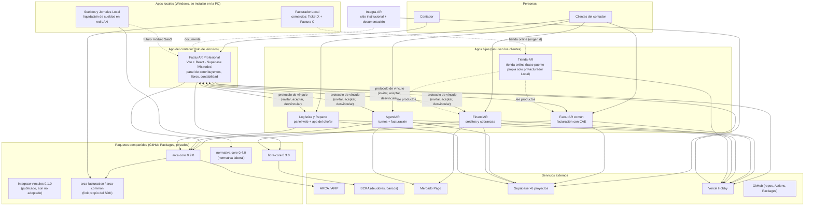

# Ecosistema IntegraAR — MD general del ecosistema (estado al 31/10/2026)

> **Este es el MD general del ecosistema (documento de entrada).** En **toda** sesión nueva —se trabaje sobre una app o sobre varias— se lee este archivo primero y después el MD de la app que se va a tratar (norma en §0).
> Se mantiene en el repo `Integra-AR` (el sitio institucional) porque es el único que no pertenece a ninguna app. Cuando cambie algo que cruza apps (vínculos, paquetes, backups, CI, secretos), se actualiza **acá y en el repo afectado**.
> Nunca se guardan valores de secretos en estos archivos: solo sus nombres y dónde viven. Los archivos `SECRETOS_*.md` de cada repo están fuera de git a propósito.

---

## 0. Norma de lectura y actualización (obligatoria desde el 22/10/2026)

Vale para **toda** sesión de Claude (Claude Code, escritorio o web) sobre cualquier app del ecosistema:

1. **Primero este MD general.** Al abrir un chat o una sesión nueva se lee `ECOSISTEMA.md` completo antes de tocar nada.
2. **Después el MD de la app tratada**, según la tabla "Documento de cada app" de §2.
3. **Al cerrar un cambio se actualizan los dos:** el MD de la app (detalle, con fecha) y este general (fecha de la cabecera, la fila de la app en §2 y §10, los pendientes de §7 y, si el cambio cruza apps, las secciones 3 a 5).
4. **Si no coinciden**, se verifica contra el código, la base de Supabase y Vercel, y se corrigen los dos. Ningún MD se da por actualizado sin mirarlo.

Dónde está escrita la norma: en `C:\Desarrollo Integrar\CLAUDE.md` (Claude Code lo carga solo en cualquier subcarpeta), en el `CLAUDE.md` de cada repo y en la cabecera del MD principal de cada app.

---

## 1. Qué es

IntegraAR es un conjunto de aplicaciones para pymes y profesionales argentinos con integración real a ARCA/AFIP y Mercado Pago. Hay **una app para el contador** (FacturAR Profesional) y **apps "hijas"** que usan los clientes del contador. El contador invita a un cliente desde Profesional; el cliente acepta desde su app hija y desde ahí el contador opera con él.

### Organigrama



---

## 2. Las aplicaciones

| App | Repo (GitHub `tustylovt-ui/…`) | Carpeta local (`C:\Desarrollo Integrar\…`) | Rama | Stack | Vercel (proyecto · URL) | Supabase (project ref · cuenta) |
|---|---|---|---|---|---|---|
| **FacturAR Profesional** (contador) | `FacturAR-Profesional` | `FACTURAR\FacturAR-Profesional` | `main` | Vite 7 + React 18 | `facturar-profesional` · facturar-profesional.vercel.app | `pvukzwxwbzkmspdgjoqw` · "Mis redes" |
| **FacturAR común** (núcleo) | `FacturAR` | `FACTURAR\FacturAR` | `main` | Vite 7 + React 18 | `factur-ar` · factur-ar.vercel.app | `tehgzhnpcicuucwdefjm` · cuenta tustylovt |
| **AgendAR** | `AgendAR` | `AGENDAR\AgendAR` | `main` | Next 16 + React 19 | `agend-ar` · agend-ar-pi.vercel.app | `fkbspjyoawjwuthfhgvs` · cuenta tustylovt |
| **FinanciAR** | `FinanciAR` | `FINANCIAR\FinanciAR` | `main` | Next 15 + React 19 | `financi-ar` · financi-ar.vercel.app | `izprfefxvwsjtnmpempi` · cuenta integraar.soluciones |
| **Logística y Reparto** (LR) | `Logistica-y-Reparto` | `LOGISTICAYREPARTO\Logistica-y-Reparto` (`dashboard-web/` + `app-repartidor/`) | **`master`** | Next 16 + React 19; app del chofer en Expo 57 | `logistica-reparto` · dashboard-web-five-rho.vercel.app · `lr-updates-integraar` (OTA de la app del chofer, carpeta `updates-server/`) | `mnuilbwxanbhnlrblitu` · "Inversiones" |
| **Tienda-AR** | `Tienda-AR` | `TIENDAAR\Tienda-AR` | `main` | Next 15 | `tienda-ar` | `afbuaxrccittcfhbcwoi` · misma cuenta que FinanciAR. **Base puente propia solo para Facturador Local** (origen `d`: `tienda_config`, `tienda_productos`, `tienda_pedidos`, `v_tienda_publica`). Para FacturAR (`f`) y FinanciAR (`c`) lee y escribe directo en las bases de esas apps. |
| **Integra-AR** (sitio + docs) | `Integra-AR` | `INTEGRAAR\Integra-AR` | `main` | HTML estático | `integra-ar` | — |
| **Facturador Local** (comercio, escritorio) | sin remoto (git local) | `Facturador Local` (variante más simple, sin SQLite/IA/tienda: `Facturador Rapido`) | `master` | Node 24 + Express + SQLite (`better-sqlite3`), sin framework; instalador `.exe` | — | sin base propia; su tienda online usa la base puente de Tienda-AR (origen `d`) |
| **Sueldos y Jornales Local** | sin remoto (git local) | `Sueldos y Jornales Local` | `main` | Node + TypeScript (`sueldos-core`), servidor en LAN con HTTPS, base local cifrada | — | — (más adelante pasa a módulo SaaS de Profesional) |

**TiendaAR es un módulo, no una app aparte para el usuario:** se activa desde FacturAR común (origen `f`), FinanciAR (origen `c`) y Facturador Local (origen `d`); el repo `Tienda-AR` es la vidriera pública y el checkout que comparten.

### Documento de cada app (el MD que se lee después de este)

| App | MD principal | Complementarios |
|---|---|---|
| FacturAR común | `FACTURAR\FacturAR\ESTADO_FACTURAR.md` | `PENDIENTES.md`, `ESTADO_FACTURAR_DB.md`, `BACKUPS.md`, `ARCA_SCRAPING.md` · 29/10: datos del emisor en el PDF con `arca-core` 0.10.0 (PR #31) |
| FacturAR Profesional | `FACTURAR\FacturAR-Profesional\PENDIENTES.md` | `VARIANTE_PROFESIONAL.md`, `LEEME_VARIANTE.md`, `BACKUPS.md`, `MAPA_DEPENDENCIAS_MODULOS.md` · 29/10: datos del emisor en el PDF con `arca-core` 0.10.0 (PR #37) |
| AgendAR | `AGENDAR\AgendAR\ESTADO AGENDAR.md` | `PENDIENTES.md`, `DESARROLLO.md`, `BACKUPS.md` |
| FinanciAR | `FINANCIAR\FinanciAR\ESTADO_FINANCIAR.md` | `PENDIENTES.md`, `HISTORIAL_FINANCIAR.md`, `BACKUPS.md` |
| Logística y Reparto | `LOGISTICAYREPARTO\Logistica-y-Reparto\README.md` | `dashboard-web\README.md` · 29/10: datos del emisor en el PDF con `arca-core` 0.10.0 (PR #33) · 29/10: orden de visita como camino abierto, app (PR #34) y panel (PR #35) · 31/10: actualizaciones por aire (OTA) de la app del chofer, servidor en Vercel (PR #36 y #37; PR de la app en curso) |
| TiendaAR (módulo) | `TIENDAAR\Tienda-AR\ESTADO_TIENDAAR.md` | `README.md` |
| Integra-AR (sitio) | `INTEGRAAR\Integra-AR\ESTADO.md` | `PROTOCOLO_VINCULO_CONTADOR.md`, `SEGURIDAD_TOKENS.md` |
| Facturador Local | `Facturador Local\DESARROLLO_TECNICO.md` | `README.md`, `COBROS_MERCADOPAGO.md` |
| Sueldos y Jornales Local | `Sueldos y Jornales Local\DESARROLLO.md` | `docs\*.md`, `packages\sueldos-core\README.md`; la planilla Excel aparte: `Liquidacion Sueldo\trabajo\DESARROLLO.md` |

Fuera del ecosistema (misma carpeta, no se relevan acá): AgroDron Tech, App Chino Mandarin, Finanzas personales, Reparto-AR, UltimaMilla y GestionAR.

Notas que cambian cómo se trabaja:
- **LR tiene dos copias locales con roles distintos:** `…\LOGISTICAYREPARTO\Logistica-y-Reparto` es el trabajo diario (código, migraciones, backups); `C:\dev\lr` es **solo para compilar la app del chofer** (ruta corta por el límite de 260 caracteres de Windows; tiene `android/` y los `.env.local`). No editar código en las dos a la vez. **Desde la reinstalación de Windows (18/10) `C:\dev\lr` necesita `git config --global --add safe.directory C:/dev/lr` (hecho el 29/10) y se reinstaló la cadena de compilación de Android el 29/10/2026 (JDK 17 + SDK sin Android Studio en `…\AppData\Local\Android`, variables `JAVA_HOME`/`ANDROID_HOME` de usuario); detalle y comando en el README de LR.**
- **FacturAR Profesional tiene dos remotos** (`origin` = Profesional, `upstream` = núcleo). `gh` quedó fijado a Profesional con `gh repo set-default`. En los demás repos pasar siempre `--repo` si hay dudas.
- **Las cuentas (organizaciones) de Supabase son cuatro**, una por correo (verificado con los conectores el 22/10/2026): tustylovt (FacturAR común + AgendAR), ucachasrl / "Mis redes" (Profesional + AgroDron Tech, ajeno al ecosistema), integraar.soluciones (FinanciAR + base puente de Tienda-AR) y fagottijorger / "Inversiones" (LR + Finanzas Personales). Para mirar una base en el navegador hay que tener abierta la cuenta correcta. **Desde el 08/10/2026 hay 4 conectores MCP locales con token propio** (los tokens viven en la configuración de la app de escritorio, nunca en estos documentos): `supabase-agendar-facturar` (FacturAR común `tehgzhnpcicuucwdefjm` + AgendAR `fkbspjyoawjwuthfhgvs`), `supabase-misredes` (Profesional `pvukzwxwbzkmspdgjoqw`), `supabase-financiar-tienda` (FinanciAR `izprfefxvwsjtnmpempi` + base puente de Tienda-AR `afbuaxrccittcfhbcwoi`) y `supabase-lr-finanzas` (LR `mnuilbwxanbhnlrblitu` + "Finanzas Personales" `xgsdbkxerbttybyuclwp`, esta última pausada y ajena al ecosistema). Un conector de claude.ai ve también LR. Si un token vence o se revoca, el conector responde `Unauthorized`.
- **Cuenta de prueba de FinanciAR = misma identidad fiscal que la del dueño en FacturAR común** (CUIT 20258523173, mismo certificado): cualquier emisión de prueba es real (CAE real) y comparte numeración. Pedir OK antes de emitir.

---

## 3. Paquetes compartidos (carpeta `Logica Arca\`)

Se publican como paquetes **privados** en GitHub Packages (`@tustylovt-ui/…`). Para instalarlos hace falta `GH_PACKAGES_TOKEN` (en local, exportarlo en la terminal; en CI, secret del repo; en Vercel ya está en todos los entornos).

| Paquete | Versión | Qué hace | Lo usan |
|---|---|---|---|
| `arca-core` | 0.9.0 (27/10/2026: `clasesDeEmisor` y `tiposFiscalesDeEmisor` en `/documentos`) | Reglas y utilidades ARCA: tipos de comprobante, IVA, QR RG 4291, TokenCache, catálogo de reglas, comprobantes asociados RG 4540 (subpath `/asociados`; **el front nunca importa la raíz del paquete**) | núcleo 0.9.0 · Profesional 0.9.0 · AgendAR 0.9.0 · LR 0.9.0 · **FinanciAR 0.9.0** (migrada el 27/10) · **ninguna app usa todavía el motor `clasificarComprobante`** |
| `facturador-core` | **0.6.0 publicado** (27/10/2026: IVA incluido para cobros de importe fijo, `DocumentoNuevo.ivaIncluido`; 0.5.2 del 27/10: condición de IVA con la constancia y diagnóstico de estructura; 0.5.0 del 25/10: padrón con certificado de la app, diagnóstico de tiempos y padrón rápido; 0.1.0 a 0.3.1 anteriores) | Facturador completo sobre `arca-core`: condición IVA y cliente por CUIT/DNI, tipo de documento automático, Factura/NC/ND/Recibo con y sin CAE, asociación por número o CAE, saldo de facturas, persistencia inyectable y hooks de React sin estilos. Plan y relevamiento: `PLAN.md` del repo (antes `Logica Arca\PLAN_FACTURADOR_CORE.md`) | todas (migración de a una: LR → AgendAR → FinanciAR → FacturAR común → Profesional → Facturador Local) |
| `arca-facturacion` / `arca-common` | **0.1.2** (25/10/2026: `consultarCuitDetalle` usa `ws_sr_constancia_inscripcion` y el parser lee su respuesta; publicado a mano con token `write:packages`, PR #1 del fork mergeado el 27/10 con CI verde) | Fork propio del SDK de ARCA (la cuenta `ramiidv` **no** es propia) | vía `arca-core`; AgendAR y LR lo declaran directo |
| `bcra-core` | 0.3.0 | Central de Deudores, CUIT y tabla de bancos (nombres completados con padrón A5 y API de cheques; `soloCheques`, `incompleto`) | Profesional 0.3.0 · FinanciAR 0.1.1 (solo usa deudores y CUIT) |
| `integraar-vinculos` | 0.1.0 | Contrato del protocolo de vínculo v2, firma por par, registro de apps y capacidades | **Publicado pero ninguna app lo adoptó todavía** (etapa A1 del plan `PLAN_PAQUETES_VINCULOS_Y_SCRAPING.md`). Hoy el protocolo vive duplicado en el código de cada app. |
| `normativa-core` | 0.4.0 | Normativa laboral versionada por vigencia (SMVM, topes SIPA, feriados por jurisdicción, datasets de convenios), manifiesto firmado Ed25519; vigilancia diaria del Boletín Oficial publicada en Vercel (`normativa-vigilancia`) | Sueldos y Jornales Local (carpeta `Logica Normativa\`) |
| `sueldos-core` | 0.0.1 (local) | Núcleo de cálculo de sueldos: mensual, quincenal, semanal, jornal y hora, SAC, vacaciones, liquidación final, embargos, Ganancias | Sueldos y Jornales Local (`packages\sueldos-core`; todavía no se publica) |

Cada paquete se publica por GitHub Actions al crear un tag `vX.Y.Z`. Planes y decisiones: `Logica Arca\PLAN_*.md`.

---

## 4. Cómo se conectan: el protocolo de vínculo contador ↔ cliente

Documento técnico completo: [`PROTOCOLO_VINCULO_CONTADOR.md`](PROTOCOLO_VINCULO_CONTADOR.md). Resumen operativo vigente:

**Piezas**
- `vinculos_contador` (Profesional): el vínculo **maestro** (contador, contribuyente, estado `PENDIENTE/ACTIVO/REVOCADO`, código de invitación).
- `vinculos_contador_apps` (Profesional): una fila por app hija del vínculo (`financiar`, `agendar`, `logisticayreparto`, `facturar_comun`) con su estado (`ACTIVO/PENDIENTE/ERROR/REVOCADO`).
- `vinculos_contador_externo` (en **cada app hija**): el lado receptor de la invitación (código, estado, usuario que aceptó).
- Todo lo server-to-server viaja con el secreto compartido `INTEGRAAR_INTERAPP_SECRET` (cabecera `X-IntegraAR-Secret`), nunca con datos del navegador.

**Flujo de alta**
1. El contador usa "Invitar contribuyente" en Profesional (nombre, email **opcional**, apps a vincular).
2. Profesional crea el vínculo maestro y le pide a cada app tildada que cree su invitación (`vinculo_externo_crear`).
3. El cliente abre el link `/acceso/<código>` de su app hija, inicia sesión o se registra y acepta.
4. La app hija avisa a Profesional (`notificar_activacion_externa`) **con el email de la cuenta con que aceptó** (`datos.email`; agregado el 08/10/2026 en FinanciAR, AgendAR, LR y FacturAR común).
5. Profesional crea (o reutiliza) la cuenta interna del cliente por email y deja el vínculo maestro **ACTIVO**: queda **una sola tarjeta** en el panel con todo (vinculación total), con una etiqueta por app junto al nombre.

**Flujo de baja (desde 08/10/2026 siempre es TOTAL, venga de donde venga)**
- *Contador desde el panel:* el "Desvincular" de cualquier tarjeta corta **todas las apps vivas del cliente y el vínculo nativo**, y la tarjeta desaparece.
- *Cliente desde su app hija:* la app avisa (`notificar_desvinculacion_externa`) y Profesional corta **las demás apps y el vínculo nativo** (`api/_lib/desvinculacionTotal.js`).
- *Cliente desde Profesional ("Desvincularme"):* mismo corte total.
- **Guarda de cuenta compartida:** si el mismo contribuyente tiene **otro vínculo activo**, la baja no lo degrada a INDEPENDIENTE ni cancela sus suscripciones (caso real: la cuenta del dueño está en dos vínculos).
- Una app que no responde al corte queda en `ERROR` y se informa en el log; el resto igual se corta.

**Probado en producción el 08/10/2026 con FinanciAR:** alta sin email en la invitación → tarjeta ACTIVA en 2,5 s; baja desde el cliente → todo REVOCADO en 1,2 s; baja desde el panel → todo REVOCADO en 1,6 s; la cuenta compartida quedó intacta. **Baja iniciada por el cliente desde FacturAR común, probada el 09/10/2026 (12:36 UTC) con la cuenta del dueño:** vínculo `d7512b6a…` y su app REVOCADOS en Profesional, invitación REVOCADA en el núcleo, rol pasó a `INDEPENDIENTE` (no tenía otro vínculo activo); los vínculos de MARCELA y de LR no cambiaron. Con esto la baja iniciada por el cliente quedó probada en las cuatro apps hijas. Para volver a operar hay que re-invitar desde Profesional. **09/10/2026 con AgendAR:** baja desde el panel del contador → vínculo, app e invitación REVOCADOS en las dos bases, vínculo de FacturAR común y rol del contribuyente intactos (guarda de cuenta compartida); alta nueva → tarjeta ACTIVA. **Baja iniciada por el cliente desde Logística y Reparto, probada el 09/10/2026 (05:40 UTC):** mismo resultado (vínculo, app e invitación REVOCADOS en las dos bases; cuenta compartida intacta). **Datos fiscales en la activación (09/10/2026):** AgendAR y LR ahora informan CUIT, razón social y condición además del email (`datos`), como FacturAR común; verificado en producción con LR (la tarjeta pasó de CUIT `PENDIENTE` a los datos reales y muestra el botón ARCA). **Baja iniciada por el cliente desde AgendAR, probada el 09/10/2026 (05:19 UTC):** vínculo `0b272d08…` y su app REVOCADOS en Profesional en ~1 s, invitación REVOCADA en AgendAR, vínculo de FacturAR común y rol del contribuyente intactos; logs de Profesional sin errores (solo el aviso `DEP0169`).

**Tarjeta del panel (09/10/2026):** una sola tarjeta por vínculo. La app de datos del cliente (FacturAR común, o la primera activa con comprobantes/emisión: AgendAR, Logística y Reparto) se absorbe como etiqueta en "Vinculación total" y la tarjeta opera sobre ella; ya no hay una segunda caja con otro Desvincular.

---

## 5. Infraestructura transversal

**CI (GitHub Actions)** — todos los repos con paquetes privados necesitan el secret `GH_PACKAGES_TOKEN` y pasarlo a `npm ci` (`env:`). Estado al 08/10/2026: verde en núcleo, Profesional, AgendAR, FinanciAR y LR. Los pre-push (Husky) corren tests + build en cada repo.

**Lint** — `0 errores` en los cinco; los avisos no bloquean. Quedan avisos como deuda: AgendAR 83 (33 `set-state-in-effect`, 45 `exhaustive-deps`), FinanciAR 239 (198 `no-explicit-any`), LR 21. FinanciAR **no tenía configuración de ESLint** hasta el 07/10 (el job "informativo" nunca analizaba nada).

**Keep-alive de Supabase** — workflow `Integra-AR/.github/workflows/supabase-keepalive.yml` (lunes y jueves, 6 bases, solo lectura; ver §7 punto 0).

**Certificado de la app para el padrón (regla del dueño, escrita el 23/10/2026):** las consultas al padrón de ARCA (razón social y condición de IVA del cliente) se hacen **siempre con el certificado de la aplicación**, uno solo para todo el ecosistema y con todas las relaciones de padrón autorizadas. **Nunca con el certificado de cada cliente**, que solo tiene wsfe: así no hay que agregar servicios al CUIT de cada cliente. Variables `ARCA_CERT`, `ARCA_PRIVATE_KEY`, `ARCA_CUIT` y `ARCA_AMBIENTE` (FacturAR, AgendAR y FinanciAR ya las usaban; LR usaba el de la empresa y se corrigió el 23/10). Desde `facturador-core` 0.3.0 la consulta está en el paquete (`buscarClienteConCertificadoApp`), así cada app la llama en una línea. **Conviene cargar las cuatro una sola vez como variables compartidas del equipo en Vercel**, vinculadas a todos los proyectos. **Aviso de vencimiento:** el workflow `certificado-app-vencimiento.yml` de este repo revisa todos los días el certificado público (secreto `ARCA_APP_CERT`) y falla desde 15 días antes del vencimiento, con lo que llega el mail de GitHub. Al renovar: ARCA → Vercel (variables compartidas) → secreto `ARCA_APP_CERT`.

**Backups — 22/10/2026:** la reinstalación de Windows del 18/10 borró las 5 tareas (no hubo copias entre el 07-12/10 y el 22/10). Se recrearon el 22/10 con el mismo horario (lunes; corren ocultas y al encender si la PC estaba apagada; log en `backups/ultima-corrida.log` de cada app) y se corrió una copia de cada app ese día: AgendAR 23 tablas + 6 archivos, LR 17 + 4, núcleo 45 + 16, Profesional 53 + 1, FinanciAR 30 + 6. Si se vuelve a reinstalar Windows, recrearlas así (una por app, cambiando nombre, carpeta y hora):

```powershell
$d = 'C:\Desarrollo Integrar\AGENDAR\AgendAR'   # carpeta con scripts\backup-supabase.mjs (LR: ...\dashboard-web)
$cmd = "Set-Location -LiteralPath '$d'; New-Item -ItemType Directory -Force backups | Out-Null; & node scripts\backup-supabase.mjs *> backups\ultima-corrida.log; exit `$LASTEXITCODE"
$accion = New-ScheduledTaskAction -Execute powershell.exe -Argument "-NoProfile -NonInteractive -ExecutionPolicy Bypass -WindowStyle Hidden -Command `"$cmd`"" -WorkingDirectory $d
$config = New-ScheduledTaskSettingsSet -StartWhenAvailable -AllowStartIfOnBatteries -DontStopIfGoingOnBatteries -ExecutionTimeLimit (New-TimeSpan -Hours 1)
Register-ScheduledTask -TaskName 'AgendAR Backup Supabase' -Action $accion -Trigger (New-ScheduledTaskTrigger -Weekly -DaysOfWeek Monday -At 21:00) -Settings $config -Force
```

**Backups** — cinco tareas de Windows semanales (se ejecutan al encender la PC si estaba apagada), JSON local con retención de 8, carpeta `backups/` ignorada por git:

| App | Tarea | Hora (lunes) | Cobertura |
|---|---|---|---|
| AgendAR | `AgendAR Backup Supabase` | 21:00 | tablas |
| LR | `LR Backup Supabase` | 21:30 | 17 tablas + 4 buckets de Storage |
| FacturAR común | `FacturAR Comun Backup Supabase` | 22:00 | 45 tablas · 29/10: datos del emisor en el PDF con `arca-core` 0.10.0 (PR #31) |
| Profesional | `FacturAR Profesional Backup Supabase` | 22:15 | 53 tablas (incluye todo el módulo contable) |
| FinanciAR | `FinanciAR Backup Supabase` | 22:30 | 30 tablas + 4 buckets de Storage |

Quedan fuera a propósito: vistas `v_*` y cachés reconstruibles. **Scripts de restauración** (`scripts/restaurar-backup.mjs`): las cinco apps con base propia, **probadas de punta a punta el 09/10/2026** sobre un proyecto Supabase descartable (esquema reconstruido + `--ejecutar`: 0 errores, huella de `id` idéntica al backup): FinanciAR 68 filas y 6 archivos, LR 458 filas y 4 archivos, AgendAR 33 filas y 6 archivos, Profesional 1.583 filas y 1 archivo, núcleo 543 filas y 16 archivos. Los de AgendAR (PR #25, mergeado), Profesional (#31 mergeado, #32 pendiente) y núcleo (#17 pendiente de merge) salen de una plantilla común generada del catálogo real (`TABLAS`, `FKS`, `PK`, `DIFERIDAS`, `GENERADAS`, `SOLO_SI_VACIA`, `CONTADORES_POR_TRIGGER`, `EXTRAS_DE_TRIGGER`, `SECUENCIAS`, `BUCKETS_CONOCIDOS`). Trampas de triggers resueltas: `handle_new_user` (crea `usuarios`/`professionals` al crear el usuario de Auth: se restauran por clave natural o se borran los de relleno), `trg_incrementar_uso` (infla `uso_mensual`: se restaura después y se limpia), bloqueo de período (`periodo_bloqueado_hasta` al final), asientos balanceados (partidas por lote de asiento), identidad `GENERATED ALWAYS` (`estudio_auditoria` solo si el destino está vacío), secuencias (el script imprime el SQL). **Reconstruir el esquema:** Profesional y núcleo NO se pueden armar desde `migraciones/` (a Profesional le faltaban las 01-16 y la 17: el PR #32 las versiona; núcleo empieza el 22/06 y sus tablas originales vienen del panel: usar `scripts/exportar-esquema.sql`, que genera el esquema real desde el catálogo). AgendAR: el trigger `on_auth_user_created` no está en su baseline y hay que recrearlo antes de restaurar. **Regla (09/10/2026): todo cambio de base de datos actualiza en el mismo PR los scripts de backup y restauración** (§8; está en el `CLAUDE.md` de cada repo). Hallazgos de la prueba: FinanciAR restauraba mal `plan_config`/`politicas_riesgo` (los triggers de `organizations` crean filas por defecto y las organizaciones `pro` volvían como `free`: corregido); el baseline de FinanciAR no se aplica tal cual en una base vacía (`check_function_bodies = off`), le faltan 2 cambios que viven en Tienda-AR y ~16 `ON DELETE`; LR tenía una migración registrada en producción sin archivo en el repo (`0010a`, agregada).

**Migraciones** — el repo debe coincidir con `supabase_migrations.schema_migrations` (nombre y versión). Verificado el 07/10: AgendAR, FinanciAR y LR coinciden; LR tiene `0025a_vinculos_contador_externo.sql` como *reconstrucción* verificada (la tabla existía sin migración registrada).

**Límites que ya costaron caro**
- Vercel Hobby: máximo **12 funciones serverless** por proyecto; si hay que sumar un endpoint se agrega un `servicio` a `arca-herramientas.js` (núcleo/Profesional) o un campo discriminador a una ruta existente.
- Vercel Hobby retiene **1 hora** de logs de runtime: si hay que investigar algo, hacerlo enseguida.
- Vistas Supabase pensadas para `anon` necesitan `security_invoker = false`.
- Las sesiones PWA cachean: tras un deploy, desregistrar el service worker antes de verificar en pantalla.
- En Windows: Python escribe CRLF (usar `newline=''`), los heredocs de bash rompen comillas y barras (escribir scripts con una herramienta de archivos).

---

## 6. Estado de salud por app (08/10/2026; relevamiento de fechas del 22/10/2026 en §10)

| App | CI | Lint | Tests | Migraciones = base | Backup | Documentos |
|---|---|---|---|---|---|---|
| Profesional | ✅ | 0 errores | 472 | n/d (se aplican por SQL; ver `migraciones/`) | ✅ 53 tablas | `PENDIENTES.md` al día |
| FacturAR común | ✅ | 0 errores (no bloqueante en CI) | ✅ | n/d | ✅ 45 tablas | `PENDIENTES`, `README`, `BACKUPS`, `ARCA_SCRAPING`… al día · 29/10: datos del emisor en el PDF con `arca-core` 0.10.0 (PR #31) |
| AgendAR | ✅ | 0 errores / 83 avisos (bloqueante) | 87 | ✅ | ✅ | al día |
| FinanciAR | ✅ | 0 errores / 239 avisos (bloqueante) | 173 | ✅ 31/31 | ✅ 30 + Storage | `PENDIENTES.md` con resumen verificado arriba |
| LR | ✅ (+ job `rls`) | 0 errores / 21 avisos | 139 panel + 54 app | ✅ 40 archivos (39 registradas + `0025a`) | ✅ 17 + Storage | `README.md` es el estado (sección "Relevamiento del 07/10/2026") |
| Tienda-AR | ✅ (desde el 09/10/2026: tipos + lint + build) | 0 errores / 1 aviso | ❌ no tiene | n/d (SQL manual, `migraciones/`) | ❌ la base puente **no tiene backup** (vacía, verificado 09/10/2026) | `ESTADO_TIENDAAR.md` + `README.md` (base puente corregida el 08/10/2026) |

---

## 7. Pendientes abiertos (consolidado, por prioridad; revisado el 22/10/2026)

**🚨 Nuevo (22/10/2026)**

0. **Cuatro bases de Supabase están PAUSADAS** (estado `INACTIVE` en los conectores): FacturAR Profesional (`pvukzwxwbzkmspdgjoqw`), FinanciAR (`izprfefxvwsjtnmpempi`), la base puente de Tienda-AR (`afbuaxrccittcfhbcwoi`) y Logística y Reparto (`mnuilbwxanbhnlrblitu`). Con la base pausada esas apps no funcionan en producción (login, datos, vínculos con el contador). Se reactivan con "Restore project" en el panel de Supabase de cada cuenta o con el conector. En el plan gratuito vuelven a pausarse tras ~7 días sin actividad: **Reactivadas el 22/10/2026** (LR, FinanciAR, Tienda-AR y Profesional). **Prevención:** workflow `supabase-keepalive.yml` en este repo (PR #13, mergeado el 22/10/2026): lunes y jueves 08:23 consulta 1 fila de cada una de las 6 bases con la clave pública; falla y avisa por mail si alguna no responde. Secrets cargados: `SUPABASE_ANON_KEY_FACTURAR`, `_PROFESIONAL`, `_AGENDAR`, `_FINANCIAR`, `_LR` y `_TIENDA` (clave `anon`/`publishable`, nunca la `service_role`). **Primera corrida manual (22/10/2026): las 6 bases respondieron HTTP 200.** Riesgo: en un repo público GitHub desactiva los workflows programados tras 60 días sin actividad en el repo (la norma §0 hace que este repo se actualice seguido).

0b. **Backups sin correr entre el 07-12/10 y el 22/10/2026** por la reinstalación de Windows del 18/10: tareas recreadas y copias corridas el 22/10 (§5).

**Seguridad y mantenimiento (tuyos / urgentes)**
1. Rotar el token personal de GitHub (`ghp_…`) que se pegó una vez en un chat.
2. Renovar `PACKAGES_READ_TOKEN` / `GH_PACKAGES_TOKEN` **antes del 02/01/2027** (vencen) y recargarlos en los repos y en Vercel.

**Pruebas que faltan (necesitan OK explícito cuando son emisiones reales)**

> **Orden acordado el 27/10/2026:** las pruebas con **CAE real** (NC/ND en AgendAR, puente del contador, emisión de clínica, Factura A/B de FinanciAR y las del punto 19) quedan **para lo último**. Primero se prueban en pantalla las apps que falten y se hacen las modificaciones pendientes en las aplicaciones.

3. ~~Baja iniciada por el cliente desde las apps hijas~~ ✅ probada en FinanciAR (08/10), AgendAR, LR y FacturAR común (09/10/2026; para esta última se usó la cuenta del dueño, que quedó desvinculada; usar una cuenta de prueba aparte, no la del dueño). **Cuidado con esta prueba:** en el núcleo (`api/_lib/ecosistemaReceptor.js`) aceptar una invitación nueva revoca de su lado **todos** los vínculos activos previos de esa cuenta sin avisar a Profesional (queda ACTIVO allá: inconsistencia entre bases), y `desvincularme` da de baja **todos** los vínculos activos de la cuenta y avisa uno por uno. Con la cuenta del dueño (`fagottijorger@gmail.com`, vínculo operativo `d7512b6a`, único de ese contribuyente) la baja cortaría ese vínculo y el rol pasaría a `INDEPENDIENTE`. Recomendado: una cuenta de FacturAR común de prueba nueva (el vínculo de MARCELA `6b7cf020` es de un cliente real: no tocar). Si se toca el núcleo, evaluar que `activar` avise a Profesional al revocar los vínculos previos.)
4. ~~Emisión real de NC y ND en Logística y Reparto~~ ✅ hecha el 25/10/2026 (ver punto 18); falta AgendAR. Emisión real de NC y ND en AgendAR (Profesional/núcleo ya validado con monotributista y RI).
5. Probar en pantalla el lápiz de edición del Libro IVA en el núcleo.
6. ~~`restaurar-backup.mjs --ejecutar` sobre una base descartable (LR y FinanciAR)~~ ✅ 09/10/2026. Queda: borrar el proyecto descartable `restauracion-prueba-descartable` (`zqmxxfymgnxvrrvtvccm`, cuenta "Mis redes"), que tiene copias de datos reales de las cinco apps (incluidos certificados de `arca_config`); lo borra el dueño (Settings → General → Delete project) junto con los `restaurar-*-descartable.ps1` y `limpiar-buckets.mjs` de `C:\Users\Jorge`. **22/10/2026:** ese proyecto ya no aparece en la cuenta "Mis redes" (solo están Profesional y AgroDron Tech): confirmar que se borró y eliminar los scripts locales.

**Producto / arquitectura**
7. Adoptar `integraar-vinculos` en las apps (etapa A1: firma por par, registro de apps, receptor/emisor, conformidad) para dejar de duplicar el protocolo.
8. Profesional: traer las ventas emitidas por las apps hijas al Libro IVA Ventas; completar la integración del módulo contable con el contador.
9. FinanciAR: limitación de `resolverReceptor` con Monotributista que tiene CUIT; tipar los 198 `any`; **NC/ND: decisión cambiada el 22/10/2026, se suman** al migrar a `facturador-core` (punto 18), junto con subir `arca-core`.
10. AgendAR: 33 `set-state-in-effect` y 45 `exhaustive-deps` (revisar caso por caso, hay candidatos a bugs reales).
11. `bcra-core`: CUIT de 10 entidades `soloCheques`, "Galicia S.A. vs S.A.U.", refrescar el directorio BCRA cada mes, ajuste cosmético de `marca` (0.3.1).
12. Backups: **la base puente de Tienda-AR (`afbuaxrccittcfhbcwoi`) no tiene tarea de backup, pero el 09/10/2026 se verificó que está VACÍA (0 tiendas, productos, pedidos y archivos): no hace falta hasta que Facturador Local la use** (si Facturador Local la usa, sus tiendas y pedidos solo viven ahí; verificar primero si tiene datos reales); ~~scripts de restauración y Storage en los backups de núcleo, Profesional y AgendAR~~ ✅ 09/10/2026 (probados; faltan mergear Profesional #32 y núcleo #17); respaldar la configuración de Auth.
13. Ruido de logs: aviso `DEP0169` (`url.parse()`) en las funciones de Profesional (viene de una dependencia; investigar de dónde).
14. Tienda-AR (relevado el 08/10/2026, parcialmente resuelto el 09/10/2026): se agregó CI y `next` 15.5.27 con `npm audit fix` (vulnerabilidades de producción 7 → 4, sin críticas). Pendiente: `mercadopago` 3.x (cambio mayor, afecta el cobro) y Next 16 para lo que queda, tests del checkout y `zod` declarado sin uso. Detalle en `Tienda-AR\ESTADO_TIENDAAR.md`.
15. "Leaked password protection" de Supabase Auth requiere plan Pro (bloqueado por plan).
16. ~~🔒 Núcleo: política `Ver invitacion pendiente` abierta y `calcular_facturacion_anual`/`puede_emitir_factura` ejecutables por cualquiera~~ ✅ **Corregido el 22/10/2026** (FacturAR PR #22 + migración `20261022215003_seguridad_invitacion_y_funciones`, verificada con el rol `anon`).
16b. ~~🔒 LR: `spatial_ref_sys` (PostGIS) escribible por `anon`/`authenticated` (aviso crítico del asesor)~~ ✅ **Corregido el 22/10/2026**: la tabla es de `supabase_admin` y no admite RLS ni revocar permisos, así que se bloqueó con triggers que rechazan toda escritura salvo de los roles administradores (migración `20261022220000` = archivo `0026`, LR PR #16). Verificado con `anon`: escribir da `42501`, leer y `geography` siguen funcionando.
17. **Pendientes por app verificados el 22/10/2026:** cada MD principal tiene arriba un bloque "Pendientes reales al 22/10/2026" con lo que sigue abierto y lo que ya se resolvió.
18. **🧾 Facturador completo `facturador-core` (idea y decisiones del dueño, 22/10/2026) — PRÓXIMO TRABAJO PRINCIPAL.** Paquete **nuevo** (usa `arca-core`), se comparte **la lógica** (hooks sin estilos; cada app su UI) y **FinanciAR se suma**. Relevamiento: `arca-core` ya tiene el motor de clasificación (sin usar), asociados RG 4540 y condiciones IVA; faltan en todas las apps el **DNI** (todas mandan DocTipo 80 o 99), recibos con CAE (solo LR emite RC), vínculo real recibo↔factura, asociar por **CAE** y unificar la emisión (hoy duplicada). Orden: repo + CI → `arca-core` 0.8.0 (DNI, asociados por CAE, documento siguiente) → fork con `getIdPersonaListByDocumento` (padrón A13, probar contra ARCA real) → `facturador-core` 0.1.0 → migrar LR, AgendAR, FinanciAR, FacturAR común, Profesional, Facturador Local. Detalle: `Logica Arca\PLAN_FACTURADOR_CORE.md`.
   - **Avance 23/10/2026 — paso 1 hecho:** `arca-core` **0.8.0** en el PR #1 de `arca-core` (CI en verde contra el SDK real; falta merge + tag `v0.8.0` para publicar). Suma el módulo `documentos` (subpath `/documentos`, sin dependencias): validación de CUIT/DNI, CUIT/CUIL posibles desde un DNI, `resolverDocumentoReceptor` (DocTipo 80/96/99) y `documentosSiguientes` (qué NC/ND/recibo corresponde); en `asociados`, búsqueda por CAE (`buscarPorCae`) y `para: 'recibo'`. También agrega CI en los PRs de `arca-core` (antes solo corría al publicar). **Siguiente:** paso 0 (crear el repo `facturador-core`, lo crea el dueño en GitHub) y paso 2 (búsqueda por DNI en el fork: con `cuitsPosiblesDesdeDni` se puede consultar el padrón A13 por CUIT sin `getIdPersonaListByDocumento`; probar contra ARCA real). Avance también anotado en `PLAN_FACTURADOR_CORE.md` §3.
   - **23/10/2026:** `arca-core` **0.8.0 publicado** (tag `v0.8.0`, workflow OK). Repo `facturador-core` creado por el dueño; **0.1.0 en el PR #1 de `facturador-core`**: modelo de documento único, tipo automático (motor `clasificarComprobante` + clase del origen para NC/ND/recibos), importes, armado WSFEv1 con DNI (96), `emitir` con puertos de ARCA y repositorio inyectables, adaptador `WsfeClient`, comprobantes X, `saldoFactura` y `validarAsociacion`; 22 tests. **Bloqueo:** el CI da 401 hasta que el dueño cargue el secreto `PACKAGES_READ_TOKEN` en ese repo. El plan pasó a `PLAN.md` del repo (la copia de la PC queda como antecedente). Faltan para 0.2: padrón por CUIT/DNI, conversión X → fiscal, WSFEX y hooks de React; después, migrar LR.
   - **23/10/2026 (tarde):** el dueño cargó `PACKAGES_READ_TOKEN` → CI en verde; **0.1.0 mergeado y publicado** (tag `v0.1.0` desde la PC; copia local en `Logica Arca\facturador-core`). **0.2.0 en el PR #2** (CI en verde, 39 tests): `buscarCliente` por CUIT/DNI con el padrón (A5/A13; con DNI prueba los CUIT/CUIL posibles, sin tocar el fork), `convertirXaFiscal` y hooks de React sin estilos en el subpath `/react`. Pendiente: probar el padrón por DNI contra ARCA real y WSFEX (al migrar FacturAR común). **Siguiente: migrar LR al paquete.**
   - **25/10/2026 — LR migrada y probada con CAE real:** el PR #17 (emisión con `facturador-core`) y el PR #19 (Consultar con el certificado de la app) están en producción. Las variables compartidas del equipo `ARCA_CERT`, `ARCA_PRIVATE_KEY`, `ARCA_CUIT` y `ARCA_AMBIENTE` están cargadas y **vinculadas a `logistica-reparto`** (Production y Preview; Vercel no deja vincular una variable sensible al entorno Development, hay que sacarlo). Prueba real en producción (CUIT emisor 20258523173, receptor 27-17729200-7, punto de venta 7): padrón OK (nombre + condición; 14 a 24 s por consulta, corregido después), **3 Facturas C de $100 (FC 36, 37 y 38), 3 ND C de $10 (2, 3 y 4), 3 NC C de $110 (1, 2 y 3) y 1 Recibo C suelto de $100**, todos con CAE y guardados. Las NC quedaron asociadas a su factura (`nc_origen_id`); las ND y el recibo no tienen columna de asociación en la base de LR. **Pendientes de esto:** (a) ~~la consulta del padrón tarda 14 a 24 s~~ → resuelto en parte, ver el avance siguiente; (b) el nombre del receptor no se completa al asociar un comprobante, y el formulario no tiene campo de observaciones; (c) comprobar en ARCA (`FECompConsultar`) que las ND salieron con el comprobante asociado.
   - **25/10/2026 (noche) — padrón más rápido (`facturador-core` 0.4.0 y 0.5.0, LR PR #21 y #22 en producción):** se midió en producción con `onIntento`/`diagnostico` (la ruta de LR acepta `?diagnostico=1` y loguea "padrón lento" si pasa de 5 s). **Causa de los 14 a 24 s: el servicio A5 (`ws_sr_padron_a5`) responde `coe.notAuthorized` ("Computador no autorizado a acceder al servicio") para el certificado de la app `facturarprod`, y ARCA tarda ~11 s en rechazarlo (el SDK lo reintentaba: hasta 22 s); recién después A13 responde en ~1,5 s.** Arreglo en 0.5.0: un servicio rechazado como "no autorizado" se saltea 1 h por instancia (`noAutorizados`) y el cliente de padrón usa `retries: 0`. Resultado: consultas en tibio ~1,5 s; **la primera de cada instancia en frío sigue pagando ~11 s**. **Resolución final (misma noche):** el A5 está dado de baja; el reemplazo oficial es `ws_sr_constancia_inscripcion` y el certificado de la app **ya tenía esa relación** (ARCA respondió "ya existe"). El fork `arca-facturacion` 0.1.1 cambió `consultarCuitDetalle` a ese servicio y 0.1.2 corrigió el parser (0.1.1 respondía rápido pero sin razón social). LR PR #24 y #25 en producción. **Medido: en tibio ~0,7 s del servicio (1,8 s total), en frío ~2 s (3,2 s total); antes 14 a 24 s.** Trae razón social y domicilio. **Condición de IVA resuelta el 27/10/2026 (`facturador-core` 0.5.2, LR PR #29):** la constancia informa el estado como `AC` y solo se reconocía "ACTIVO"; ahora el CUIT del dueño sale Monotributista y la búsqueda por DNI funciona. `?diagnostico=1` devuelve también `estructura`. **LR 27/10:** campo Observaciones en Facturación y receptor tomado del comprobante asociado (PR #27, sin cambios de base). **Fork `arca-facturacion`:** la rama del PR #1 ya trae lock, `.npmrc` y workflows `ci.yml`/`publicar.yml` como el resto de los repos (publica en GitHub Packages, no en npmjs); el CI queda rojo solo hasta que el dueño cargue el secreto `PACKAGES_READ_TOKEN` en ese repo (lee `arca-common`), después se mergea. **Pendientes de LR:** columna de asociación para ND/recibo (requiere migración y actualizar backup/restauración; hoy los asociados quedan en observaciones), verificar en ARCA con `FECompConsultar` que las ND salieron con comprobante asociado (el armado ya tiene test; falta la verificación del lado de ARCA con el certificado de la empresa). El pendiente anterior "autorizar `ws_sr_padron_a5`" queda **anulado**. **Fork:** el PR #1 sigue abierto (su CI está rojo desde el 29/09 por no tener lock ni secreto de lectura, como el resto de los repos; el código 0.1.1/0.1.2 está publicado pero la rama principal del fork aún no lo tiene). Tokens (solo nombres): `GH_PUBLISH_TOKEN` (publicar, `write:packages`) y `GH_PACKAGES_TOKEN` (leer, referenciado por `.npmrc`) en las variables de usuario de la PC; revocar el token de lectura que se pegó por error en una sesión anterior.
   - **27/10/2026 (noche) — FinanciAR migrada (paso 1) y `facturador-core` 0.6.0:** al migrar se midió que el cálculo normal del facturador (neto por ítem + IVA redondeado) deja el total con 1 centavo de diferencia en el **17 %** de los importes (ej. $10,00 → $9,99), y FinanciAR cobra importes fijos (cuotas) con el IVA adentro. `facturador-core` **0.6.0** (PR #9, publicado) agrega `ivaIncluido`: el total es exactamente lo cobrado y el neto/IVA salen de `desglosarIvaIncluido` de arca-core. FinanciAR **PR #41 mergeado**: `arca-core` 0.5.0 → 0.9.0, se suma `facturador-core` 0.6.0 y `convertirAFiscal.ts` pide el CAE por `emitir` (`ivaIncluido`) con un puerto propio (`src/lib/arca/arcaPuerto.ts`); el guardado en `comprobantes` queda igual; 7 tests nuevos; sin cambios de base. **Falta (paso 2):** NC, ND, recibos y asociación a facturas en FinanciAR, y la **prueba con CAE real** de la conversión (FC y Factura A/B a un RI), que queda para lo último con OK del dueño.
   - **27/10/2026 (tarde) — tipos de comprobante por condición del emisor:** un Monotributista/Exento veía Factura B y NC/ND B en AgendAR (listas propias en 3 pantallas) y un Exento también en LR, FacturAR y FacturAR Profesional. La regla compartida de arca-core es: Responsable Inscripto → A/B; Monotributo y Exento → solo C. Corregido: AgendAR PR #32 (función `tiposPorCondicion.ts` con test contra `determinarClaseBase`), LR PR #31, FacturAR PR #29, FacturAR Profesional PR #35 (todos mergeados). FinanciAR resuelve el tipo automático con la regla compartida y Tienda-AR no tiene esa pantalla: sin cambios. **Centralizado (27/10, noche):** `arca-core` **0.9.0 publicado** exporta `clasesDeEmisor` y `tiposFiscalesDeEmisor` (subpath `/documentos`, sin SDK; RI → FA/FB/NCA/NCB/NDA/NDB, Monotributo y Exento → FC/NCC/NDC, condición desconocida → C). Las cuatro apps ya la usan, todo mergeado: AgendAR PR #33 (se borró `tiposPorCondicion.ts`), LR PR #32, FacturAR PR #30 y FacturAR Profesional PR #36 (`src/lib/tiposEmisor.js`; el receptor de un RI sigue decidiendo A/B). Cada una subió `arca-core` a `^0.9.0` y su lock. El perfil del dueño en AgendAR figuraba `EXENTO` aunque ARCA lo tiene Monotributista: **corregido el 27/10/2026** con un UPDATE de una sola fila (`billing_config.tipo_contribuyente` = `MONOTRIBUTISTA`, CUIT 20258523173, PV 7), verificado con SELECT.
19. **Siguen abiertos de esta sesión (22/10/2026):** NC y ND reales con CAE en LR y AgendAR (esperan OK del dueño, factura e importe); FinanciAR Factura A/B a un RI con CAE real; Profesional Libro IVA Ventas desde las apps hijas; Tienda-AR `mercadopago` 3.x + tests; páginas del sitio Integra-AR para Profesional, Facturador Local y Sueldos (+ OG tags, dominio propio). Facturador Local y Sueldos y Jornales siguen solo en local hasta terminarlos.
20. **🧩 Facturador Local: implementar los módulos necesarios de todos los creados (pedido del dueño, 27/10/2026).** Hoy es la variante más simple (Ticket X + Factura C, sin remoto, solo git local). Pendiente: relevar los módulos que ya existen en las demás apps (facturador completo `facturador-core`, padrón con el certificado de la app, Libro IVA, caja, catálogo, cobros, tienda, etc.), decidir cuáles necesita un comercio y sumarlos reusando los paquetes compartidos en lugar de copiar código. Sin urgencia: se hace después de las pruebas con CAE real; antes de empezar, definir con el dueño qué módulos entran.
21. **🧾 Datos del emisor en los PDF de todas las apps (detectado por el dueño el 28/10/2026 con la NC C 0007-00000004 de AgendAR).** Verificado en el código, sin cambios todavía:
    - **Ingresos Brutos:** AgendAR, FacturAR, Profesional y LR imprimen el CUIT cuando no hay número cargado. Corregir: campo manual "Ingresos Brutos" en la configuración de cada app y, si está vacío, **no mostrar la línea** (nunca el CUIT). FinanciAR: revisar si su PDF lo imprime.
    - **Fecha de Inicio de Actividades:** AgendAR la tiene fija en "—" (ni siquiera tiene columna en `billing_config`); FacturAR, Profesional y LR leen un campo del perfil que hoy no se completa solo. Corregir: traerla del padrón al cargar el certificado/consultar el CUIT, guardarla en el perfil fiscal y mostrarla en el PDF.
    - **Condición frente al IVA:** el perfil del dueño en AgendAR ya está corregido a MONOTRIBUTISTA (27/10); ese PDF se generó antes y salió "Exento". Falta: que la carga del certificado la deje seteada en **todas** las apps. En AgendAR la detección por padrón existe, pero si no encuentra el impuesto por su descripción de texto devuelve EXENTO (puede dejar mal a un monotributista): usar la lógica compartida de arca-core y no caer en "Exento" por defecto. Verificar el perfil real del dueño en FacturAR, Profesional, LR y FinanciAR.
    - Idealmente va en un paquete compartido (arca-core / facturador-core) para no repetirlo en cada app. 
    - **Criterio del dueño (28/10):** la condición IVA y el inicio de actividades se dejan seteados **al cargar el certificado** (consulta al padrón con el certificado de la app) y se **revalidan en los meses de recategorización (enero y julio)**. Ingresos Brutos es siempre manual; vacío = no se imprime.
    - **Hecho 28/10:** `arca-core` **0.10.0** (`perfilEmisorDesdePadron`, `inicioActividadesDesdePadron`, `formatearInicioActividades`, `debeRevalidarPerfilEmisor`; PR #3). **AgendAR ✅** (PR #35 y #36): IIBB manual y oculto si está vacío, columnas `fecha_inicio_actividades` y `perfil_fiscal_consultado_at` (migración 20261028201332, aplicada), cron `0 12 2-8 1,7 *` → `/api/billing/revalidar-perfil-cron`. Probado con el certificado real: quedó MONOTRIBUTISTA e inicio `2026-02`.
    - **Hallazgo:** la consulta A13 del padrón **no devuelve impuestos**; sólo la constancia A5 (`consultarCuitDetalle`) los trae, con períodos AAAAMM (el padrón no da el día exacto). Por eso AgendAR consulta A5 primero y cae a A13. Las demás apps deben hacer lo mismo.
    - **Hecho 29/10:** el dueño confirmó que `2026-02` es el alta de su monotributo (correcto). Mismo arreglo (IIBB manual y oculto si está vacío; condición e inicio desde el padrón al guardar el certificado y cada 7 días, que cubre enero/julio; el inicio manual nunca se pisa) en **FacturAR común ✅** (PR #31), **FacturAR Profesional ✅** (PR #37) y **Logística y Reparto ✅** (PR #33; el inicio se guarda como día 01 y el PDF imprime MM/AAAA). Los tres usan `arca-core` 0.10.0.
    - **Hecho 29/10 (FinanciAR ✅, PR #42):** su PDF no imprimía Ingresos Brutos (no tenía el bug del CUIT) ni condición IVA ni inicio, y la condición salía de A13 (caía en Exento). Ahora sale de la constancia A5 con el certificado de la app (`arca-core` 0.10.0, mapeo `MONOTRIBUTISTA`→`MONOTRIBUTO`); migración `20261029210614` en `arca_config` (`ingresos_brutos`, `fecha_inicio_actividades`, `perfil_fiscal_consultado_at`); revalidación al abrir la pantalla de ARCA si pasaron 7 días o es enero/julio. **Las 5 apps con PDF quedaron hechas.**
    - **Pendiente:** probar con el certificado real en FacturAR, Profesional, LR y FinanciAR (guardar el certificado, revisar condición e inicio, cargar IIBB, generar un PDF); verificar el QR de ARCA en un PDF de NC regenerado (opcional; requiere OK por ser UPDATE en producción o emitir con CAE).

22. **🚚 LR: orden de visita mal calculado (29/10/2026).** Caso real del dueño en Venado Tuerto: con dos paradas (a 2 km y a 200 km) la app marcaba primero la lejana (398 km en vez de 201). **Causa** (reproducida contra la API de Mapbox): se pedía a la Optimization API un viaje de ida y vuelta (`roundtrip=true`) y se descartaba el último tramo; eso optimiza el circuito, no el camino, y con dos paradas ambos órdenes cuestan lo mismo. **Corregido** con la Matrix API de Mapbox + un solucionador de camino abierto propio (`ordenRuta.ts`, exacto hasta 12 paradas; copia en la app y en el panel: si se cambia, cambiar las dos): **app PR #34 mergeado** (APK compilado el 30/10/2026 01:07, pendiente de probar en el celular real, junto con la búsqueda de calles de Rufino); **panel PR #35 abierto** (al mergear se despliega en producción). Las rutas ya calculadas con el orden viejo no se corrigen solas: hay que recalcularlas. Verificado el 30/10 que ninguna otra app del ecosistema usa `optimized-trips`. Detalle: `Logistica-y-Reparto\README.md`, entrada 12 de "EMPEZAR ACÁ".
23. **📲 LR: actualizaciones por aire (OTA) de la app del chofer (29-31/10/2026).** Para no depender de un APK nuevo por cada cambio de JavaScript, la app consulta al abrirse un servidor propio y aplica el código nuevo en el siguiente arranque en frío. **Servidor:** carpeta `updates-server/` del repo de LR, proyecto de Vercel propio `lr-updates-integraar` (equipo `team_i0GhK9dzwQtB6TJ8GBNdvDEV`, Authentication solo en previews), URL `https://lr-updates-integraar.vercel.app/api/manifest`, protocolo Expo Updates v1 con código **firmado** (RSA-SHA256; certificado público en el repo, vence 2036-10-27; la clave privada vive solo en la PC del dueño, `C:\Users\Jorge\.lr-updates\private-key.pem`, con copia guardada por él el 31/10; no está en Vercel ni en GitHub). **Runtime = huella del proyecto**: una actualización solo llega a los APK con la misma huella; `updates-server/runtimes.json` lista las de los APK instalados y el comando de publicar se niega a publicar contra una que ningún APK tiene. **Estado:** servidor desplegado y verificado en producción; app con `expo-updates` 57.0.26 y APK nuevo compilado el 30/10 (runtime `3650614885386e33805db320125294b8df2ab83b`, misma firma que el instalado); PR de la app y primera actualización piloto en la rama `feat/ota-app` de LR. **Pendiente:** mergear ese PR, instalar el APK en el celular y confirmar que la pantalla de direcciones pasa a "Actualización del …"; y confirmar en el celular los arreglos de orden y de búsqueda de calles. **Trampas de compilación** (detalle en el README de LR, punto 13): `expo prebuild` borra `android/` aunque no se pida `--clean`; el paso `lintVital` se cuelga en esta PC (se saltea con `-x`); hay que verificar que `assets/fingerprint` del APK coincida con `expo-updates runtimeversion:resolve`. No afecta a las demás apps.

---

## 8. Acuerdos de trabajo (cómo se opera con Claude y entre apps)

- **Primero este MD general y después el de la app; al cerrar un cambio se actualizan los dos** (norma §0, desde el 22/10/2026).
- **Una app a la vez**, con rama + PR + CI en verde + OK explícito del dueño antes de mergear a la rama principal. Commits con `Co-Authored-By: Claude …`.
- **Pedir OK explícito** antes de: emisiones fiscales reales (CAE), migraciones/UPDATE/DELETE en producción, publicar secretos.
- **Los secretos los carga el dueño** en GitHub/Vercel/Supabase; Claude prepara el formulario con el nombre y el valor vacío. No se pegan tokens en el chat.
- **Probar cambios del ecosistema = deploy real + prueba en el navegador + verificar ambas bases + documentar** (ver `FacturAR\…\PENDIENTES.md` y la memoria del proyecto).
- **Cambios de base de datos ⇒ copia de seguridad (regla del 09/10/2026).** Toda modificación de una base de datos (migración, SQL a mano o panel de Supabase) debe actualizar **en el mismo PR**: la lista `TABLAS` (y buckets de Storage) de `scripts/backup-supabase.mjs`; en las apps que lo tienen (FinanciAR, LR) también `TABLAS`, `FKS`, `PK`, `DIFERIDAS` y `BUCKETS_CONOCIDOS` de `scripts/restaurar-backup.mjs`; la migración versionada con el mismo nombre y versión registrados en `schema_migrations`; y los números de `BACKUPS.md`/README. Si un trigger inserta filas por defecto en otra tabla, esa tabla se restaura por su clave natural. La regla está escrita en el `CLAUDE.md` de FacturAR, Profesional, AgendAR, FinanciAR, Logística y Reparto y Tienda-AR (se carga sola en cada sesión de Claude Code). Verificación: correr el backup, comparar `TABLAS` con `/rest/v1/` de PostgREST y correr la simulación de restauración.
- **Verificar antes de afirmar:** los documentos se corrigen contra el código y la base reales; los `.md` locales no versionados (`ESTADO_*`, `SECRETOS_*`) no se dan por actualizados sin mirarlos.
- Los repos usan finales de línea CRLF en Windows (`autocrlf`): los scripts que editan archivos deben respetarlos.

---

## 9. Dónde leer más

| Tema | Archivo |
|---|---|
| Protocolo de vínculo (contrato, endpoints, rollout) | `Integra-AR\PROTOCOLO_VINCULO_CONTADOR.md` |
| Lecciones operativas históricas (junio 2026; leer con este documento al lado) | `Integra-AR\GUIA_CLAUDE_ECOSISTEMA.md` |
| Sitio institucional | `Integra-AR\ESTADO.md` |
| Profesional: pendientes e historia detallada; qué es la variante | `FacturAR-Profesional\PENDIENTES.md`, `VARIANTE_PROFESIONAL.md`, `LEEME_VARIANTE.md`, `ARCA_SCRAPING.md`, `MAPA_DEPENDENCIAS_MODULOS.md` |
| Núcleo: pendientes, scraping ARCA, mapa de módulos, backups, recuperación | `FacturAR\PENDIENTES.md`, `ARCA_SCRAPING.md`, `MAPA_DEPENDENCIAS_MODULOS.md`, `BACKUPS.md`, `RECUPERACION_DESASTRES.md` |
| AgendAR / FinanciAR | `AgendAR\PENDIENTES.md` + `DESARROLLO.md`; `FinanciAR\PENDIENTES.md` (resumen verificado arriba) + `BACKUPS.md` + `migraciones\README.md` |
| LR | `Logistica-y-Reparto\README.md` |
| Paquetes y planes | `Logica Arca\PLAN_PAQUETE_ARCA_COMPARTIDO.md`, `PLAN_FORK_ARCA_SDK.md`, `PLAN_PAQUETES_VINCULOS_Y_SCRAPING.md` y el README/CHANGELOG de cada paquete |
| Facturador Local | `Facturador Local\DESARROLLO_TECNICO.md`, `README.md`, `COBROS_MERCADOPAGO.md` |
| Sueldos y Jornales Local, planilla Excel y normativa | `Sueldos y Jornales Local\DESARROLLO.md` + `docs\`; `Liquidacion Sueldo\trabajo\DESARROLLO.md`; `Logica Normativa\normativa-core\README.md` + `PENDIENTES.md` |
| Control de actualización de los MD | §10 de este archivo |

---

## 10. Control de actualización de los documentos (relevado el 22/10/2026)

**Cómo se relevó:** fecha de modificación de cada MD en disco, último commit local y de `origin`, último deploy de producción en Vercel, última migración registrada y estado del proyecto en Supabase (conectores locales). Al cerrar un cambio en una app, actualizar su fila.

| App | MD de la app (modificado) | Último commit en la rama principal | Último deploy prod. Vercel | Última migración Supabase | Base | ¿MD al día? |
|---|---|---|---|---|---|---|
| FacturAR común | `ESTADO_FACTURAR.md` 07/10 · `PENDIENTES.md` 08/10 · `BACKUPS.md` 09/10 · 27/10: tipos de comprobante por condición del emisor con `arca-core` 0.9.0 (PR #29 y #30; `PENDIENTES.md` al día) | 09/10 22:34 (PR #17) | 09/10 (PR #17) ✅ | 24/09 `seguridad_is_admin_suscripciones_uso` | ✅ activa | ✅ Sí. La restauración del 09/10 está en `BACKUPS.md`, no en `ESTADO_FACTURAR.md` (menor). · 29/10: datos del emisor en el PDF con `arca-core` 0.10.0 (PR #31) |
| FacturAR Profesional | `PENDIENTES.md` 27/10 (padrón del receptor PR #28 y emisión del puente del contador PR #29, ambos con `facturador-core`; y PR #30: `arca-emitir` y emisión de clínica piden el CAE por `facturador-core` con resguardos de importes y fecha; el guardado sigue en las pantallas; CAE real probado el 27/10: FC 0007-00000039/40/41, NC C 0007-00000004 y ND C 0007-00000005, PV 7, producción; tipos por condición del emisor con `arca-core` 0.9.0 (PR #35 y #36); falta probar el puente del contador y la clínica; recibos de AgendAR son internos sin CAE) · `README.md` 29/09 · `VARIANTE_PROFESIONAL.md` 26/09 | 09/10 22:34 (PR #32) | 09/10 (PR #32) ✅ | no se pudo leer (base pausada) | ⛔ **pausada** | ✅ `PENDIENTES.md` al día. ⚠️ `README.md` y `VARIANTE_PROFESIONAL.md` son de septiembre: revisar que reflejen el módulo contable. · 29/10: datos del emisor en el PDF con `arca-core` 0.10.0 (PR #37) |
| AgendAR | `ESTADO AGENDAR.md` 07/10 · `PENDIENTES.md` 09/10 · `BACKUPS.md` 09/10 · 27/10: tipos por condición del emisor con `arca-core` 0.9.0 (PR #32 y #33; `PENDIENTES.md` al día) · 28/10: datos del emisor en el PDF con `arca-core` 0.10.0 (PR #35 y #36) | 09/10 12:38 (PR #25) | 09/10 (PR #25) ✅ | 02/09 `billing_comprobantes_emitido_por_externo` | ✅ activa | ✅ Casi. ⚠️ La cabecera de `ESTADO AGENDAR.md` todavía dice que el CI falla por falta de `GH_PACKAGES_TOKEN` (07/10), pero §6 lo da en verde desde el 08/10: corregir esa frase. |
| FinanciAR | `ESTADO_FINANCIAR.md` 07/10 · `PENDIENTES.md` 08/10 · `BACKUPS.md` 09/10 · 27/10: conversión X→fiscal por `facturador-core` 0.6.0 y `arca-core` 0.9.0 (PR #41; `PENDIENTES.md` al día) | 09/10 22:42 (PR #27) | 09/10 (PR #27) ✅ | no se pudo leer (base pausada) | ⛔ **pausada** | ⚠️ No: el PR #27 (09/10, datos fiscales al activar el vínculo) no figura en `ESTADO_FINANCIAR.md` ni en `PENDIENTES.md` (solo acá, §4). `README.md` es del 15/09. · 29/10: datos del emisor en el PDF con `arca-core` 0.10.0 y migración de `arca_config` (PR #42) |
| Logística y Reparto | `README.md` 31/10 · 27/10: tipos por condición del emisor con `arca-core` 0.9.0 (PR #31 y #32) | 29/10 (PR #33 datos del emisor, PR #34 orden de visita en la app; 25/10 PR #22 a #29: padrón rápido y condición de IVA con constancia de inscripción, fork 0.1.2, facturador-core 0.5.2; 27/10 observaciones y receptor del asociado) | 29/10 (PR #33) ✅ | 22/10 `bloquear_escritura_spatial_ref_sys` | ✅ activa (reactivada el 22/10) | ✅ Sí. · 29/10: datos del emisor en el PDF con `arca-core` 0.10.0 (PR #33) |
| TiendaAR (módulo) | `ESTADO_TIENDAAR.md` 09/10 · `README.md` 09/10 | 09/10 22:51 (PR #6) | 09/10 (PR #6) ✅ | n/d (SQL manual en `migraciones/`) | ⛔ base puente **pausada** (vacía) | ✅ Sí. |
| Integra-AR (sitio + este MD) | `ECOSISTEMA.md` 22/10 · `ESTADO.md` 23/09 | `main` 22/10 (PR #12 protocolo y PR #13 keep-alive, mergeados) | 09/10 (PR #11) ✅ | — | — | ⚠️ `ESTADO.md` (23/09) no incluye FacturAR Profesional, Facturador Local ni Sueldos y Jornales en el sitio. Este MD y la norma §0 van en el PR `docs/norma-md-general`. |
| Facturador Local | `DESARROLLO_TECNICO.md` 29/09 · `README.md` 01/08 | 29/09 17:54 (git local, sin remoto) | — (app local, instalador `.exe`) | — | — | ⚠️ El encabezado dice "Última actualización: 14/08/2026" y §2 todavía dice "persistencia en JSON" (el código ya usa SQLite). El README se titula "Facturador Rápido". |
| Facturador Rápido (variante simple) | `DESARROLLO_TECNICO.md` 29/09 · `README.md` 14/08 | 29/09 17:54 (git local) | — | — | — | Definir si sigue viva o se archiva. |
| Sueldos y Jornales Local | `DESARROLLO.md` 21/10 (§46–§47 **sin commitear**) | 15/10 13:13 (git local, sin remoto) | — (local) | — (base local cifrada) | — | ✅ Al día; falta commitear `DESARROLLO.md`. |
| Planilla Excel de sueldos (`Liquidacion Sueldo`) | `trabajo\DESARROLLO.md` 21/10 | sin git | — | — | — | ✅ Al día (producto aparte; oráculo de pruebas de Sueldos). |
| Paquetes | `arca-core` 04/10 · `bcra-core` 06/10 · `integraar-vinculos` 09/10 (rama `docs/contrato-alineado-produccion` sin mergear) · `normativa-core` 15/10 | — | `normativa-vigilancia` 13/10 ✅ | — | — | ✅ |

**Conclusión del relevamiento:** desde el 09/10/2026 no hubo cambios de código, deploys ni migraciones en las apps web. El trabajo del 10 al 21/10 fue en Sueldos y Jornales Local, la planilla Excel de sueldos y `normativa-core`. Los MD de las apps web reflejan ese estado, salvo las excepciones marcadas con ⚠️. Las ramas locales de núcleo, Profesional, AgendAR, FinanciAR y Tienda-AR ya están mergeadas y quedaron 1 commit atrás de `main`: hacer `git switch main && git pull` antes de seguir.
